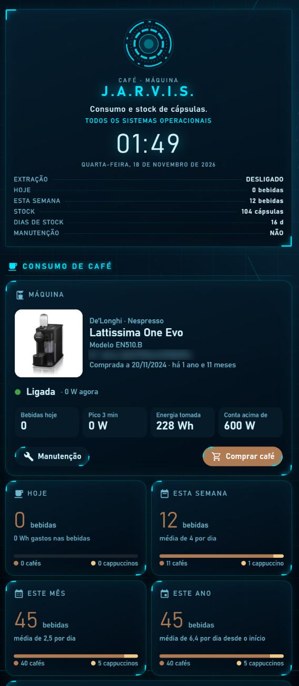
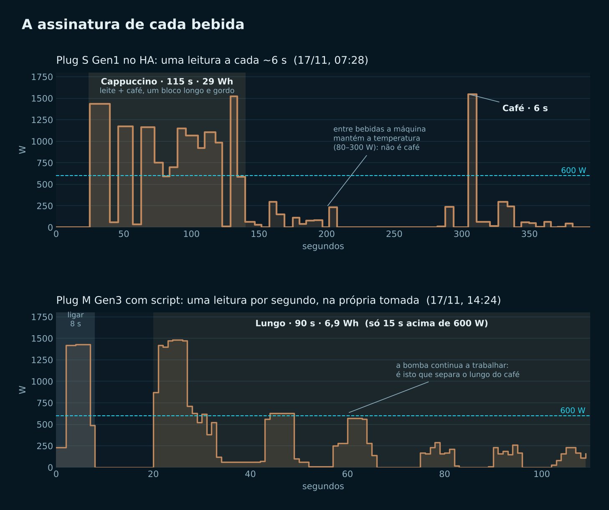
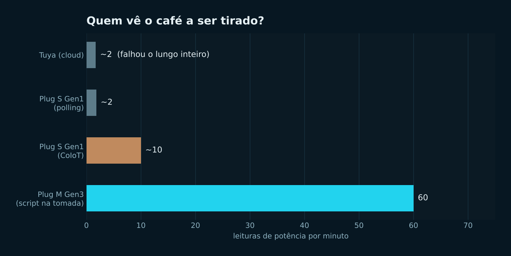
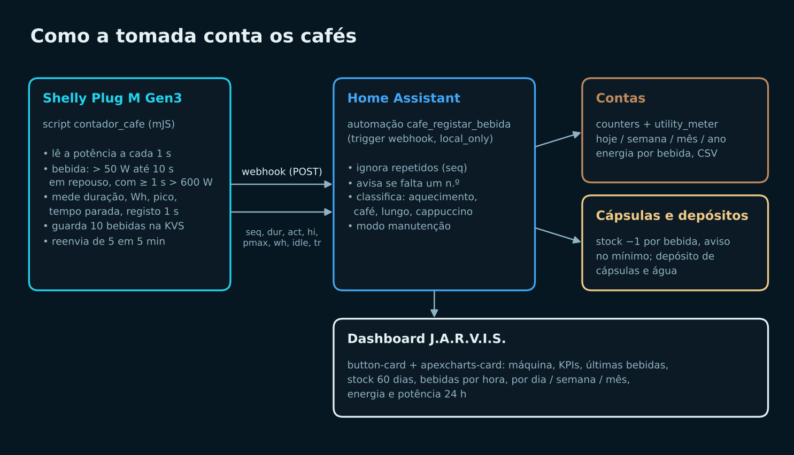
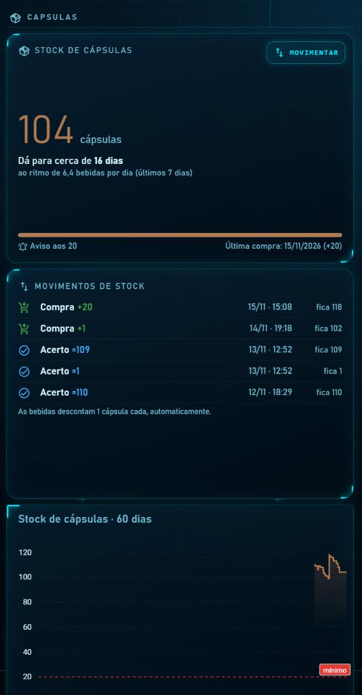
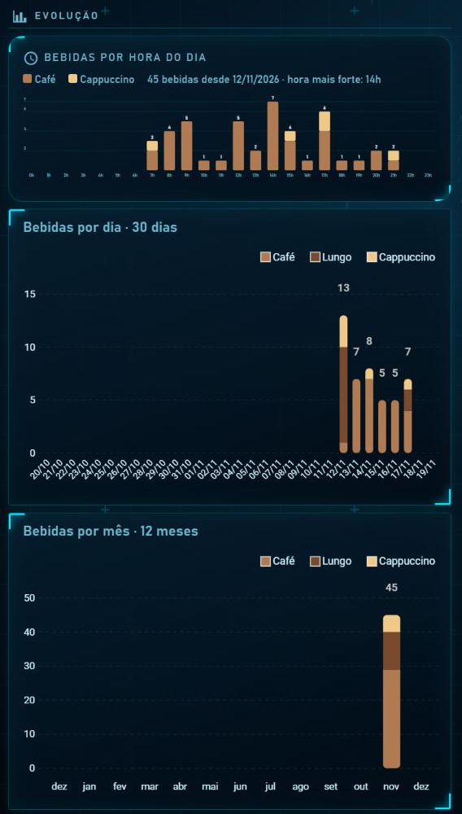
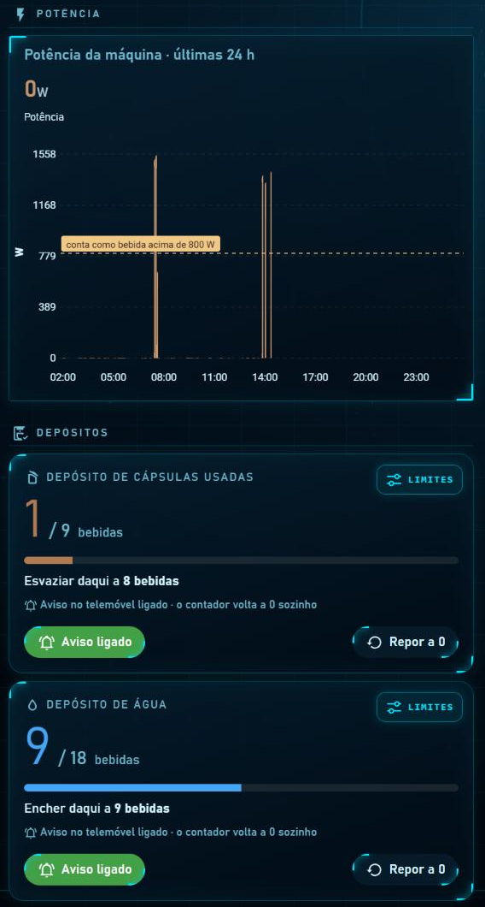

# ☕ Shelly Coffee Counter for Home Assistant

**English** · [Português](README.pt.md)

Count every coffee your machine makes, tell an espresso from a lungo and a cappuccino, and keep track of capsule stock and the used-capsule and water tanks. All of it from a smart plug, with no integration for the coffee machine itself.

The detection runs **on the plug** (a Shelly Plug M Gen3 running an mJS script, sampling power every second). Home Assistant only receives a finished "drink" over a webhook, classifies it and does the bookkeeping.



## Why on the plug?

The first version did everything in Home Assistant, from the readings of a Shelly Plug S Gen1. It never got quite right:

- readings arrived every 33 s at first (every ~6 s after switching CoIoT to unicast), and an espresso lasts about 12 s;
- switching the machine on looks exactly like a coffee (11–17 s at ~1400 W);
- a warm-up followed by a coffee merged into one block, or split into two, depending on luck;
- a lungo once counted as two coffees because a 655 W reading in the tail opened a new block.

A Tuya cloud plug was even worse (one reading every ~35 s; it missed a whole lungo). Moving the detection onto the plug, at 1 s resolution, solved all of it.





## How it works



**On the plug** (`shelly/contador_cafe.js`):

- a session starts when power goes above 50 W and ends after 10 s in a row below 50 W;
- it only counts if there was at least 1 s above 600 W (the heater);
- at the end it POSTs a JSON to a Home Assistant webhook with: sequence number, total duration, seconds working, seconds above 600 W, peak power, Wh, idle time before, and the per-second power trace;
- every drink is stored in the plug's KVS (10 slots) and anything not acknowledged by HA is resent every 5 minutes, even after a reboot.

**In Home Assistant** (`packages/cafe.yaml`):

- duplicates are dropped by sequence number, and a gap in the sequence sends a phone notification;
- classification: less than 15 s working → just switching on (not counted); ≥ 35 s and ≥ 13 Wh → cappuccino; ≥ 70 s → lungo; anything else → coffee (all thresholds are `input_number` helpers);
- counters and `utility_meter` for today / week / month / year, energy per drink, a CSV log;
- capsule stock (each drink takes one; purchases and corrections are logged; phone alert at the minimum level, with a shortcut to the shop) and "days of stock left" at the last-7-days rate;
- used-capsule tank and water tank counters with a configurable limit, phone alert and automatic reset;
- maintenance mode, so descaling does not count as 30 coffees (turns itself off after 2 h).

## Repository layout

| Path | What it is |
|---|---|
| `shelly/contador_cafe.js` | mJS script for the Shelly Plug M Gen3 |
| `packages/cafe.yaml` | Main HA package: helpers, counters, utility meters, stock, tanks, alerts and the webhook automation |
| `packages/cafe_shelly_m.yaml` | Template sensor with the last 15 drinks measured by the plug (for checking the classification) |
| `dashboard/vista-cafe.yaml` | The "Café" dashboard view (sections layout) |
| `docs/` | Installation guide in English and Portuguese (Markdown and Word) |
| `images/` | Screenshots and diagrams |

## Installation

A full step-by-step guide, from setting up the plug to the dashboard and troubleshooting, is in **[docs/INSTALL.md](docs/INSTALL.md)** (also as [Word](docs/Installation-guide-EN.docx)). The short version:

1. **Packages.** Copy `packages/*.yaml` to `/config/packages/` and make sure your `configuration.yaml` has:
   ```yaml
   homeassistant:
     packages: !include_dir_named packages
   ```
2. **Edit the package.**
   - replace `<O_TEU_WEBHOOK_ID>` with a random ID of your own (e.g. `cafe_m_` + 20 random characters);
   - replace `notify.mobile_app_o_teu_telemovel` with your phone's notify service;
   - the power sensor is `sensor.coffee_machine_power`: rename your plug's entity or change it in the package.
3. **Restart Home Assistant** (counters do not reload; a restart is needed the first time).
4. **Shelly script.** On the plug's web page go to *Scripts → Create script*, paste `shelly/contador_cafe.js`, set `URL` to `http://<YOUR_HA_IP>:8123/api/webhook/<YOUR_WEBHOOK_ID>`, save, start it and enable *Run on startup*.
5. **Test.** Open `http://<PLUG_IP>/script/1/teste`; a persistent notification "Teste recebido…" should appear in HA.
6. **Dashboard (optional).** Install [button-card](https://github.com/custom-cards/button-card) and [apexcharts-card](https://github.com/RomRider/apexcharts-card) from HACS, then paste `dashboard/vista-cafe.yaml` as a new view in the dashboard's raw configuration editor. The three `custom:jarvis-popup-card` cards are a personal card that is not published; remove them or replace them with your own popups.

> Entity names, labels and the dashboard are in Portuguese. The logic does not depend on them, so feel free to rename.

## Tested with

- De'Longhi Nespresso Lattissima One Evo (EN510.B)
- Shelly Plug M Gen3, firmware 2.2.0
- Home Assistant 2026.11

Other machines will have different power signatures. Look at the `tr` trace in `sensor.cafe_m_ultimos_blocos` after a few drinks and adjust the `input_number` thresholds.

## Screenshots

| Capsules | History | Power and tanks |
|---|---|---|
|  |  |  |

## License

[MIT](LICENSE) © Milton Santos
