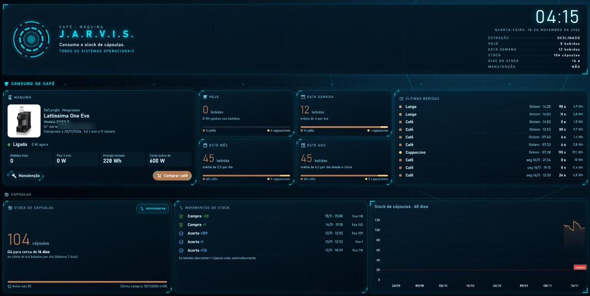
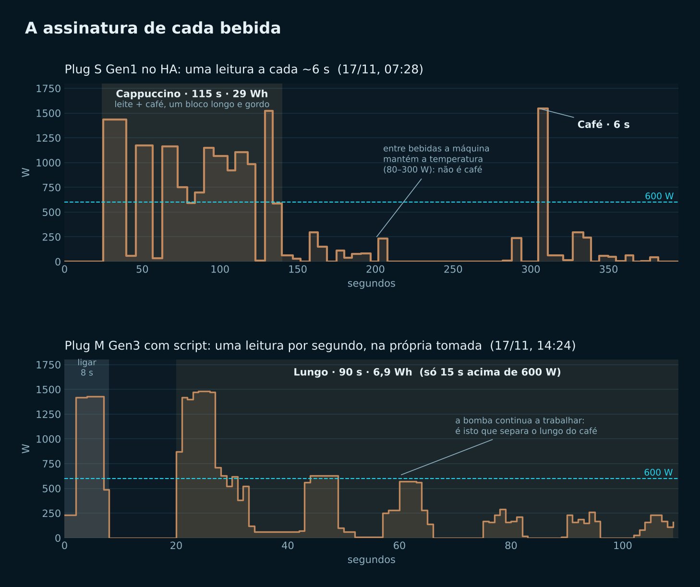
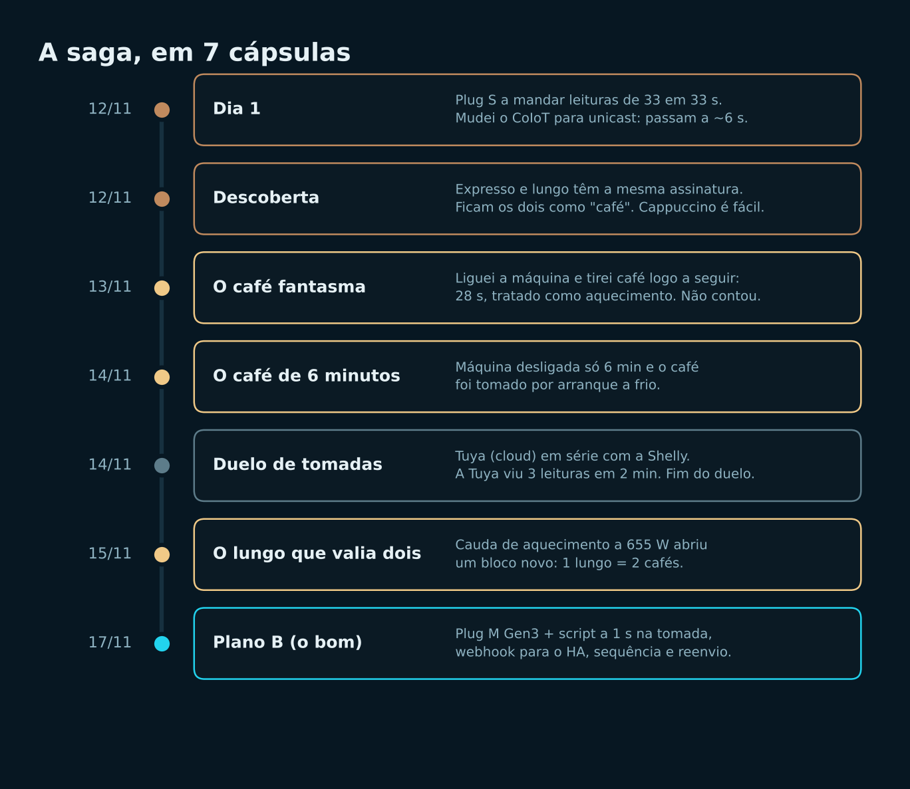
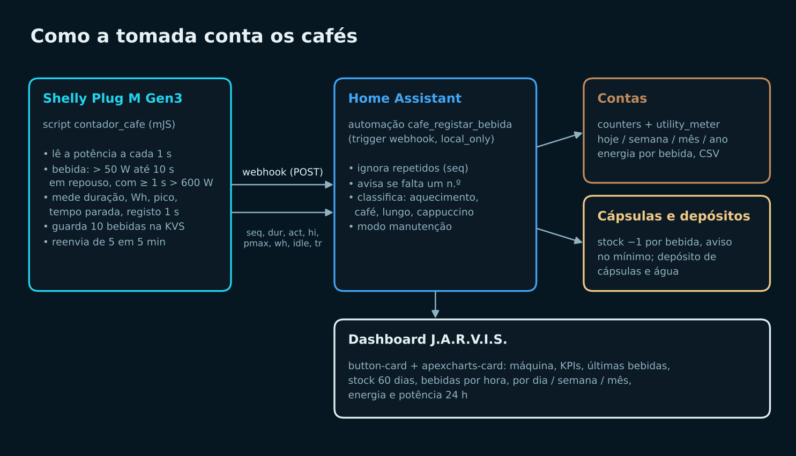
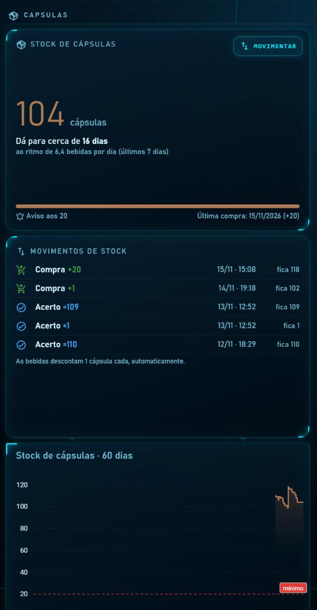
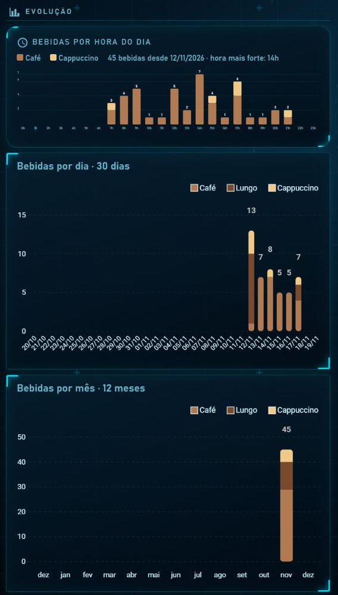
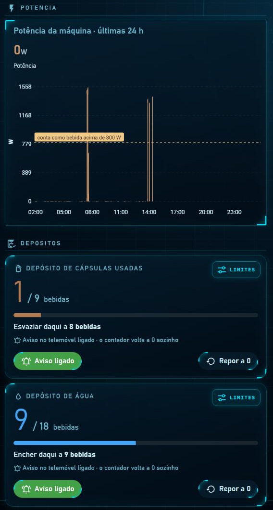

# ☕ Contador de cafés com Shelly para o Home Assistant

[English](README.md) · **Português**

Conta cada café que a máquina tira, distingue café, lungo e cappuccino, e controla o stock de cápsulas e os depósitos de cápsulas usadas e de água. Tudo a partir de uma tomada inteligente, sem integração nenhuma da máquina de café.

A deteção corre **na própria tomada** (uma Shelly Plug M Gen3 com um script mJS que lê a potência a cada segundo). O Home Assistant só recebe uma bebida já fechada, por webhook, classifica-a e trata das contas.



## Porquê na tomada?

A primeira versão fazia tudo no Home Assistant, a partir das leituras de uma Shelly Plug S Gen1, e nunca ficou bem:

- ao início as leituras chegavam de 33 em 33 s (de ~6 em 6 s depois de pôr o CoIoT em unicast), e um expresso dura uns 12 s;
- ligar a máquina parece exatamente um café (11 a 17 s a ~1400 W);
- aquecimento seguido de café ora se juntava num bloco, ora se partia em dois, conforme a sorte;
- um lungo chegou a contar como dois cafés porque uma leitura de 655 W na cauda abriu um bloco novo.

Uma tomada Tuya (cloud) foi ainda pior: uma leitura a cada ~35 s, e falhou um lungo inteiro. Passar a deteção para a tomada, com leituras de 1 s, resolveu tudo.





## Como funciona



**Na tomada** (`shelly/contador_cafe.js`):

- uma sessão começa quando a potência passa de 50 W e acaba depois de 10 s seguidos abaixo de 50 W;
- só conta se houver pelo menos 1 s acima de 600 W (a resistência);
- no fim envia um JSON para um webhook do HA com: número de sequência, duração total, segundos a trabalhar, segundos acima de 600 W, potência máxima, Wh, tempo parada antes e o registo segundo a segundo da potência;
- cada bebida fica guardada na KVS da tomada (10 lugares) e o que o HA não confirmou é reenviado de 5 em 5 minutos, mesmo depois de a tomada reiniciar.

**No Home Assistant** (`packages/cafe.yaml`):

- repetidos são ignorados pelo número de sequência, e um número em falta manda aviso para o telemóvel;
- classificação: menos de 15 s a trabalhar é só ligar a máquina (não conta); ≥ 35 s e ≥ 13 Wh é cappuccino; ≥ 70 s é lungo; o resto é café (todos os limites são helpers `input_number`);
- contadores e `utility_meter` de hoje, semana, mês e ano, energia por bebida e registo em CSV;
- stock de cápsulas (cada bebida desconta uma; compras e acertos ficam registados; aviso no telemóvel ao chegar ao mínimo, com atalho para a loja) e dias de stock ao ritmo dos últimos 7 dias;
- contadores dos depósitos de cápsulas usadas e de água, com limite configurável, aviso no telemóvel e reposição automática;
- modo manutenção, para as descalcificações não contarem como 30 cafés (desliga-se sozinho ao fim de 2 h).

## Estrutura do repositório

| Caminho | O que é |
|---|---|
| `shelly/contador_cafe.js` | Script mJS para a Shelly Plug M Gen3 |
| `packages/cafe.yaml` | Pacote principal: helpers, contadores, utility meters, stock, depósitos, avisos e a automação do webhook |
| `packages/cafe_shelly_m.yaml` | Sensor com as últimas 15 bebidas medidas pela tomada (para conferir a classificação) |
| `dashboard/vista-cafe.yaml` | A vista "Café" do dashboard (layout sections) |
| `dashboard/coffee-view.yaml` | A mesma vista em inglês |
| `docs/` | Guia de instalação em português e inglês (Markdown e Word) |
| `images/` | Capturas e diagramas |

## Instalação

O guia completo, passo a passo, da configuração da tomada ao dashboard e aos problemas comuns, está em **[docs/INSTALL.pt.md](docs/INSTALL.pt.md)** (também em [Word](docs/Guia-de-instalacao-PT.docx)). Em resumo:

1. **Pacotes.** Copia `packages/*.yaml` para `/config/packages/` e confirma que o `configuration.yaml` tem:
   ```yaml
   homeassistant:
     packages: !include_dir_named packages
   ```
2. **Ajusta o pacote.**
   - troca `<O_TEU_WEBHOOK_ID>` por um ID aleatório teu (por exemplo `cafe_m_` + 20 caracteres aleatórios);
   - troca `notify.mobile_app_o_teu_telemovel` pelo serviço de notificação do teu telemóvel;
   - o sensor de potência é o `sensor.coffee_machine_power`: muda o nome à entidade da tua tomada ou altera-o no pacote.
3. **Reinicia o Home Assistant** (os counters não têm reload; da primeira vez é preciso reiniciar).
4. **Script da Shelly.** Na página da tomada vai a *Scripts → Create script*, cola o `shelly/contador_cafe.js`, põe em `URL` o endereço `http://<IP_DO_TEU_HA>:8123/api/webhook/<O_TEU_WEBHOOK_ID>`, grava, arranca o script e ativa o arranque automático.
5. **Testa.** Abre `http://<IP_DA_TOMADA>/script/1/teste`; deve aparecer no HA uma notificação "Teste recebido…".
6. **Dashboard (opcional).** Instala o [button-card](https://github.com/custom-cards/button-card) e o [apexcharts-card](https://github.com/RomRider/apexcharts-card) pelo HACS e cola o `dashboard/vista-cafe.yaml` (ou o `dashboard/coffee-view.yaml`, em inglês) como vista nova no editor de configuração em texto do dashboard. Os três cartões `custom:jarvis-popup-card` são um cartão pessoal que não está publicado; apaga-os ou troca-os pelos teus popups.

## Testado com

- De'Longhi Nespresso Lattissima One Evo (EN510.B)
- Shelly Plug M Gen3, firmware 2.2.0
- Home Assistant 2026.11

Outras máquinas têm assinaturas de potência diferentes. Depois de umas bebidas, vê o registo `tr` no `sensor.cafe_m_ultimos_blocos` e ajusta os limites `input_number`.

## Capturas

| Cápsulas | Evolução | Potência e depósitos |
|---|---|---|
|  |  |  |

## Licença

[MIT](LICENSE) © Milton Santos
